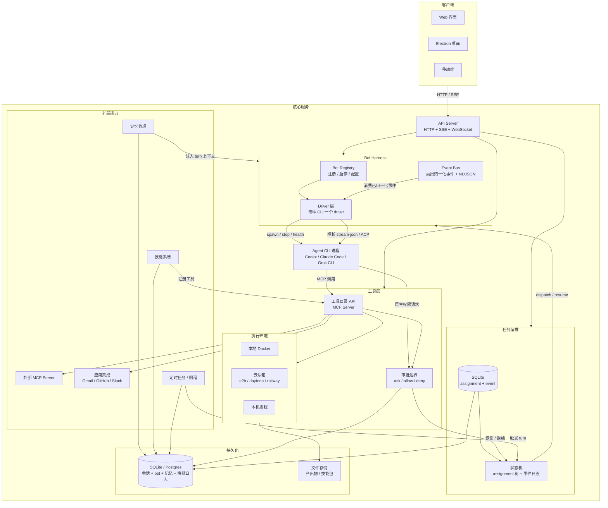

# 终版能力清单与参考实现地图

> 本文是**能力清单 + 来源参考**：终版要做哪些能力、每块参考了谁的实现、核对结论是什么。
> 它不描述落地方式；具体怎么建、接口和 v1 范围，以 `architecture.md` 为准。两份冲突时，以 `architecture.md` 为准。

产品形态：local-first 的个人 agent，可创建多个独立助手。v1 只做多 bot + 聊天 + 记忆 + 审批 + Web；例程、应用连接、电脑、协作全部后置。
终版目标：多 bot、多 provider、沙箱抽象、审批边界、记忆、技能例程、多端接入。

核心决策：不自己造 agent loop，用现成 agent CLI。自己只写进程管理、事件归一化、额外工具的 MCP server 和权限拦截。

## 架构图



## 模块清单

| 模块 | 职责 | 来源参考 |
|---|---|---|
| API Server | HTTP 路由、SSE、WebSocket | `server/routes/` |
| Bot Harness | 引擎实例注册、状态、安装检查（不管理 turn 进程） | OpenMausBot `server/harness/registry.ts` |
| Driver 层 | 进程生命周期、流解析、消息编码、审批映射 | OpenMausBot `server/drivers/claude.ts`、`server/drivers/acp/core.ts` |
| Event Bus | 消费 driver 归一化后的 `RuntimeEvent`，扇出并写 NDJSON；不解析 CLI 输出 | OpenMausBot `server/harness/bus.ts` |
| Runtime 状态机 | 多 turn / 多 bot 任务编排 | OpenMausBot `server/runtime/` |
| Runtime Store | 任务状态持久化；以行快照为权威，事件是历史，不是事件溯源 | OpenMausBot `server/runtime/store.ts` |
| 工具 MCP Server | stdio JSON-RPC；收到调用后经本地 HTTP + token 回调 harness | OpenMausBot `server/drivers/agents-proxy.ts` |
| 审批边界 | driver 原生权限拦截（Claude `--permission-prompt-tool`、ACP `session/request_permission`、Codex approval policy）+ 本地 socket broker；超时/结束/重复一律拒绝 | OpenMausBot `server/drivers/claude.ts`、`server/permission-proxy.ts`、`server/drivers/acp/core.ts` |
| 沙箱抽象 | 封闭枚举 + 工厂 switch 的 provider（docker / e2b / daytona / incus / k8s / desktop），不是运行时插件 | Rakazo `packages/adapters/src/sandbox-factory.ts` |
| 记忆管理 | Postgres 中的 markdown 文档 + 子串检索；语义检索是可选的三家固定实现 | Rakazo `packages/memory/src/index.ts` |
| 技能系统 | 技能目录、注册为 MCP 工具 | OpenMausBot `server/routes/bot-skills.ts` |
| 定时任务 | routine scheduler、触发 turn | OpenMausBot `server/routines.ts` |
| 应用集成 | connector registry（少数真正多 provider 的层） | Rakazo `packages/adapters/src/connector-registry.ts` |
| 外部 MCP | 接入第三方 MCP server | 三个项目都支持 |
| 持久化 | Postgres + Prisma only，无 SQLite / 方言抽象 | Rakazo `packages/db/prisma/schema.prisma` |
| 客户端 | Web / Electron / 移动端 | 三个项目都是 API 客户端 |

## TurnRunner 接口

Runtime 状态机只关心“启动一个 turn / 暂停 / 恢复 / 汇报”，不关心用什么模型、什么沙箱。

```typescript
interface TurnRunner {
  validate(a: Assignment, parent?: Assignment): string | undefined;
  canStart(a: Assignment): true | false | string;
  run(a: Assignment, input: RunInput, signal: AbortSignal): Promise<RunResult>;
  park(a: Assignment, question: string, restored?: boolean): void;
  report(a: Assignment, parent?: Assignment): void;
  changed(assignments: readonly Assignment[]): void;
  names(a: Assignment, parent?: Assignment): EnvelopeNames;
}
```

`run()` 的实现就是：根据 bot 配置的 driver，spawn 或复用对应的 agent CLI 进程，写入 stdin，由 driver 解析结构化输出并归一化为事件。

## Driver 接口

每种 agent CLI 一个 driver，负责五件事：

1. 怎么 spawn 这个 CLI（命令行参数、环境变量）
2. 怎么把用户消息传给 CLI（stdin 格式）
3. 怎么读 CLI 的流式输出（stream-JSON / JSON-RPC / ACP）
4. 怎么把工具目录注入（MCP server 的启动方式）
5. 怎么拦截并回答权限请求（Claude 的 `--permission-prompt-tool`、ACP 的 `session/request_permission`、Codex 的 approval policy）

## 演进路线

| 能力 | 初版 | 终版 |
|---|---|---|
| Agent 执行 | 一个 CLI | 多 CLI driver + 可选 API fallback |
| 工具 | shell + file | shell + file + browser + MCP + connector |
| 沙箱 | 本机 subprocess | Docker / cloud / local adapter |
| Bot | 单 bot | bot 列表 + 独立记忆 + 独立审批模式 |
| 会话 | 单 thread | 多 thread + group chat + subagent |
| 持久化 | SQLite | Postgres（自建 adapter；参考实现不自带可插拔层） |
| 审批 | 拦截引擎原生权限（单一入口） | 分级审批 + 通知 + 例程审批 |
| 定时任务 | 无 | routine scheduler + run history |
| 技能 | 无 | skill 目录 + skill 执行 |
| 记忆 | 会话历史 | 独立记忆包 + 检索 |
| 客户端 | 终端 CLI | Web + Electron + 移动端 |

## 设计原则

1. **Bot 是持久身份**：每个 bot 有独立的配置、记忆、工具权限和电脑。复制 bot 不复制记忆。
2. **电脑是持久工作空间**：bot 的电脑可以是本地 Docker、云沙箱或本机。容器销毁时状态可恢复。
3. **审批是产品行为，但实现挂在引擎的原生权限层**：每档审批模式透传给 provider，Violet 只负责翻译成统一的 Allow / Deny 卡片；不同 bot 可以有不同的审批模式。
4. **Provider 无关**：模型、沙箱、应用集成都通过 adapter 抽象，不锁定某一个。
5. **多端共享同一 server**：Web、桌面、移动端都是 API 客户端，不各自维护状态。
6. **状态可导出**：bot 配置、记忆、会话、工具日志都可导出和备份。
7. **不造 agent loop**：模型调用、流式输出、工具循环全部交给现成 agent CLI，自己只写进程管理、事件归一化、额外工具的 MCP server 和权限拦截。
