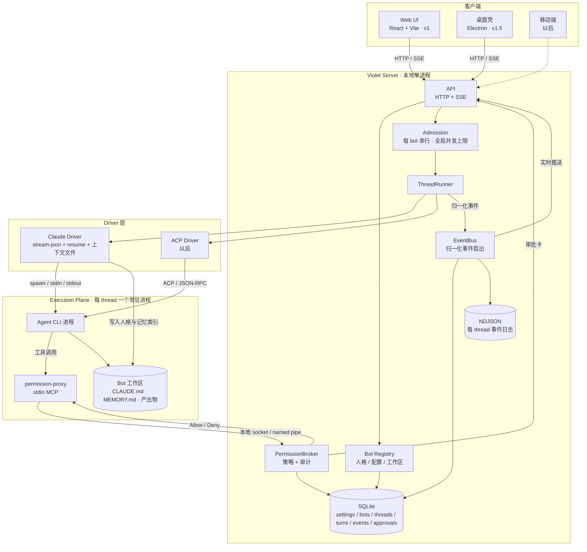

# Violet 架构

> 状态：v2 建议稿（2026-11-12）。
> 本文是**实现依据**：现在怎么建、接口长什么样、v1 交付什么。
> 终版的能力清单和参考实现地图见 `architecture-final.md`；两份文档冲突时，以本文为准。

## 1. 定位

**Violet 是一个 local-first 的个人 AI 助手：你在聊天窗口里创建多个 bot，每个 bot 有自己的名字、性格、记忆和工作区；它们用你本机已登录的 Claude / Codex 作为大脑；有副作用的动作先问你。**

不是"管理 agent 的控制平面"，也不是"给开发者用的多引擎调度器"。控制平面只是它跑起来的方式；产品是"你的助手"。

### v1 的四个产品决定

1. **多 bot**：可以创建、编辑、删除多个独立助手；每个 bot 独立人格、独立工作区、独立记忆。
2. **不做主动**：没有例程、提醒、简报（v2）。
3. **不做应用连接**：不接邮件、日历、GitHub（v2）。
4. **不做电脑**：只读写 bot 自己的工作区；浏览器 / 桌面 / 云 VM 全部后置（v3）。

> 多 bot 指的是**多个互相独立的助手**，不是多 bot 协作、群聊、委派。后者需要 assignment 树，v1 不建。

## 2. 四条不可让步的边界

### 2.1 Agent loop 永远归 CLI

模型调用、工具循环、上下文压缩、重试、流式输出，全部由 CLI 负责。Violet 不解析"模型想干什么"，只解析 CLI 告诉它"发生了什么"。

### 2.2 身份和记忆属于 Bot，不属于 Thread

人格、记忆、工作区、审批档位都挂在 bot 上；thread 只是这个 bot 的一段对话。新建 thread 不会重置人格和记忆；复制 bot 复制人格和配置，**不复制记忆**。

### 2.3 任何工具执行只有一条路径：预授权，或者过 broker

内置工具、Violet 以后加的 MCP 工具、用户配置的第三方 MCP 工具，三者都必须经过同一个策略判定。只要有一条路径能绕过 broker，审批就是装饰。

### 2.4 本地优先、单用户

数据在本机，服务只监听 `127.0.0.1`，没有账号、没有团队、没有云同步。多用户和团队是另一个产品，不在 Violet 的范围里。

## 3. 分层



关键点：

- **审批走本地 socket / named pipe**，不走 HTTP；工具和执行是两条通道。
- **每个 thread 一个常驻 CLI 进程**；bot 切换 thread 时进程可以复用，idle 回收。
- **v1 没有 violet-tools MCP**。CLI 原生工具已经够用；额外工具等有第三个真实需求再加。

## 4. 对象模型

| 实体 | 是什么 | 生命周期 | 存哪 |
|---|---|---|---|
| **Person** | 你：默认模型、时区、通知方式 | 长期 | `settings` 表 |
| **Bot** | 助手人格：名字、头像、persona、driver、model、审批档位、工作区 | 长期 | `bots` 表 + 工作区目录 |
| **Thread** | 这个 bot 的一段对话，绑定一个 CLI session id | 长期 | `threads` 表 |
| **Turn** | 一条用户消息触发的一次执行 | 秒～分钟 | `turns` 表 |
| **Process** | 跑某个 thread 的 CLI 子进程 | 可回收 | 内存 + pidfile |
| **Approval** | 一次工具审批及其结果 | 审计 | `approvals` 表 |
| **Memory** | bot 的持久记忆 | 长期 | 工作区里的 `MEMORY.md` |

状态机：

```text
Bot:    active ⇄ disabled          （删除只允许在没有 running turn 时）

Thread: idle → running → waiting_approval → running → idle
                ↘ cancelled / failed → idle

Turn:   queued → running → completed | failed | cancelled
                   ↘ paused(approval) → running

Process: starting → ready → busy → idle → stopped
                     ↘ crashed → restarting
```

`paused` 只是 UI 视角；底层就是一个阻塞中的 MCP / socket 调用，不要真的把 turn 迁出 running。

## 5. 多 bot 的运行模型

v1 的多 bot 是**资源隔离**，不是协作：

| 规则 | 值 |
|---|---|
| 每个 bot 的工作区 | `~/.violet/bots/<botId>/workspace/`，互不可见 |
| 每个 bot 的记忆 | 工作区里的 `MEMORY.md`，天然隔离 |
| 每个 bot 的并发 | 默认 1 个 running turn；其余排队 |
| 全局并发 | 默认 3 个 CLI 进程，可配置 |
| 同 thread | 严格串行 |
| 空闲回收 | 10 分钟 |
| bot 删除 | 先停进程，再删配置；工作区默认保留（可显式删除） |

不要为了"多 bot"引入共享进程池：一个 bot 的上下文、工作区、审批模式都不同，共享进程只会让隔离变复杂。

## 6. Driver 接口

```ts
export interface Driver {
  readonly kind: string;

  readonly capabilities: {
    multiTurn: boolean;
    resume: "session-id" | "load" | "none";
    stream: "stream-json" | "acp";
    /** 没有权限拦截能力的 driver 不允许进入产品 */
    approval: "permission-tool" | "acp" | "policy" | "none";
  };

  /** 起进程；沙箱以后从这里接，而不是从工具层 */
  spawn(ctx: SpawnContext): SpawnedProcess;

  /** 用户消息 → 一行 stdin */
  encode(msg: UserMessage, turn: Turn): string;

  /** CLI 一行输出 → 零个或多个归一化事件 */
  decode(line: string, turn: Turn): DriverEvent[];

  /** 把 bot 的人格与记忆索引写成引擎会加载的文件（CLAUDE.md / AGENTS.md） */
  writeContext(bot: Bot, workspace: string): Promise<void>;

  /** Claude：返回 permission-proxy 的 MCP 配置 */
  permissionTool?(broker: BrokerEndpoint, ctx: TurnContext): McpServerConfig;

  /** ACP：回答 session/request_permission */
  answerPermission?(req: PermissionRequest, decision: Decision): unknown;
}
```

能力矩阵落成代码，不是文档：每个 driver 声明支持哪些审批档位，切换 driver 时自动降级。

## 7. 记忆（v1 用文件，不建记忆系统）

v1 不引入向量库、不建记忆服务。记忆就是 bot 工作区里的两个文件：

```text
~/.violet/bots/<botId>/workspace/
  CLAUDE.md     # 每次 spawn 生成：人格 + 规则 + "持久记忆在 MEMORY.md"
  MEMORY.md     # 助手可读可写：偏好、事实、关系、决定
```

- `CLAUDE.md` 由 `Driver.writeContext()` 生成，包含 persona 和工作区规则；Claude 会自动加载，Codex 用 `AGENTS.md`。
- `MEMORY.md` 是唯一的事实源，助手用原生 Read / Write / Edit 维护；不需要额外 MCP 工具。
- 记忆隔离靠工作区隔离，不需要额外的租户字段。
- 复制 bot 时只复制 persona，不复制 `MEMORY.md`。

**要验证的坑**：`--resume` 可能沿用旧会话的系统提示，导致新写入的 `MEMORY.md` 在下一轮不生效。验收里必须包含"改完记忆，同一 thread 的下一条消息能读到它"；如果不生效，就在每次 turn 前重新生成上下文，或换用引擎的 system prompt 参数。

## 8. 审批设计

### 8.1 档位透传 provider

| Violet 档位 | Claude | ACP | Codex |
|---|---|---|---|
| ask | `--permission-mode default` | 每个 `session/request_permission` 都问 | `untrusted` |
| edits | `acceptEdits` | 只有 execute / 自定义 MCP 问 | workspace-write |
| auto | `auto` | provider 自己的能力 | `on-request` |
| full | `bypassPermissions` | harness 代答 allow | `never` |

Violet 不做自己的安全判断，只做档位映射。

### 8.2 Broker 规则

| 场景 | 行为 |
|---|---|
| 用户 Allow | 回 allow；带 `always` 时把 CLI 自己的 suggested rules 回传 |
| 用户 Deny | 回 deny + "跳过这步，说明你想做什么" |
| 15 分钟无人应答 | **deny**，来源标为 timeout |
| turn 已结束 / broker 已关闭 | **deny**，不生成新的审批卡 |
| 重复 ask id | **deny** |
| 提问（ask_user） | 不超时 |
| 引擎没给 allow 选项 | 取消这次请求，不猜 |
| SSE 断开 | 不影响等待；重连补拉未决审批 |

### 8.3 多 bot 下的审批

- 审批卡带 `botId` + `threadId`；Web UI 在对应对话里显示，同时可以在一个全局"待处理"里汇总。
- 每个 bot 的审批档位独立；不要在 bot 之间继承。
- 预授权（可信 MCP / 只读工具）也要写 `approvals`，`source: "policy"`。
- 审批日志是本地数据，不上传。

### 8.4 传输

- 审批：CLI 的 stdio MCP 代理 → 本地 socket（POSIX）/ named pipe（Windows）→ broker。
- Web：HTTP + SSE；审批决定走 `POST /api/approvals/:id`。
- token 放 `~/.violet/token`（0600），每次启动轮换；Web 由服务端在首页注入，桌面壳从同一文件读。

## 9. 进程、并发、恢复

| 问题 | v1 的答案 |
|---|---|
| 进程粒度 | 每 thread 一个常驻进程；空闲 10 分钟回收 |
| 多轮 | 持续 stdin 写 stream-json；冷启动 `--resume <session_id>` |
| 会话 id | 从 CLI 的 init 帧取，存 `threads.cli_session_id` |
| 同 thread 并发 | 严格串行；运行中来消息 → 排队 |
| 跨 thread / 跨 bot | 每 bot 1 个，全局 3 个；超出排队 |
| 切换 bot | 不杀进程；各自 thread 的进程独立 |
| 取消 | SIGTERM 进程组 → 5s → SIGKILL；Windows `taskkill /PID /T /F` |
| 崩溃残留 | supervisor 写 `~/.violet/pids/<pid>`；启动时先 taskkill 上次记录的树 |
| 重启恢复 | 未完成的 turn 标 `interrupted`，不自动续跑；新消息可 `--resume` |
| 配置隔离 | `--strict-mcp-config` + `--setting-sources project`；不要继承本机几百个工具和全局 CLAUDE.md |
| 凭证 | MCP 配置写 0600 临时文件，进程起来后删除；绝不进 argv |

事件真相：

- CLI 的 `result` 帧 = 执行真相。
- Violet 的 SQLite / NDJSON = 展示与审计真相，不要试图重建模型上下文。
- 恢复靠 `cli_session_id` + `MEMORY.md`，不是靠 replay 消息表。

## 10. 数据模型

```sql
settings(key, value)

bots(id, name, avatar, persona, driver, model,
     approval_mode, workspace, created_at)

threads(id, bot_id, cli_session_id, title,
        created_at, last_active_at)

turns(id, thread_id, status, started_at, ended_at,
      stop_reason, error)

events(id, thread_id, turn_id, seq, type, payload_json, at)

approvals(id, bot_id, thread_id, turn_id, tool, input_json,
          decision, source, requested_at, decided_at)
```

索引：`events(thread_id, seq)`、`threads(bot_id, last_active_at)`、`approvals(thread_id, decided_at)`。

文件：

```text
~/.violet/
  token
  violet.db
  pids/
  bots/<botId>/
    workspace/
      CLAUDE.md          # 生成，勿手改
      MEMORY.md          # 助手维护
      ...                # 产出物
    threads/<threadId>.ndjson
```

v1 不引入 Postgres、不引入 ORM、不引入队列服务；Node 22 自带的 `node:sqlite` 足够。

## 11. 关键流程

### 11.1 创建 bot

```text
POST /api/bots { name, persona, driver, model, approvalMode }
 → 建 bots 行 + 工作区目录
 → 写初始 CLAUDE.md / MEMORY.md
 → Web 侧栏出现新助手
```

### 11.2 发消息

```text
POST /api/threads/:id/messages
 → 建 turn(queued)
 → Admission：同 bot 有 running？排队 : 启动
 → supervisor.ensure(thread) → 写一行 stream-json 到 stdin
 → driver.decode 每一行 → events
 → EventBus：SQLite + NDJSON + SSE
 → result 帧 → turn.completed → 保存 cli_session_id
```

### 11.3 审批

```text
CLI 要执行工具
 → permission-proxy / ACP request
 → broker.ask(botId, threadId, tool, input)
 → approvals 表 + SSE 推卡片
 → 用户 POST /api/approvals/:id { allow | deny }
 → broker 唤醒 → 代理回答 CLI
 → 写审计
```

### 11.4 取消 / 重启

取消：turn.status = cancelling → interrupt → 杀进程树 → turn.cancelled。
重启：标记 interrupted → 清理 pidfile → 新消息时 `--resume` 或新 session；`MEMORY.md` 仍然在。

## 12. 客户端策略：Web 先行，桌面后包

| 阶段 | 形态 | 原因 |
|---|---|---|
| v1 | Web UI（React + Vite），`npm run dev` 起 server + UI | 热更新、DevTools、SSE 调试最方便 |
| v1.5 | Electron 壳，内嵌同一份 Web 构建 | server 是 Node，Electron 主进程直接 spawn；Tauri 还要带 Node sidecar，不划算 |
| v2 | 移动端 | 复用同一套 HTTP / SSE |

约束：

- UI **不能依赖 Electron API**；桌面独有能力通过 `window.violet` 桥接（通知、文件选择、开机启动）。
- Web 和桌面共用同一套 API 和 SSE；不要在客户端藏状态。
- 本地 Web 也要鉴权：`127.0.0.1` + bearer token，避免同机其他进程读你的对话。
- SSE 用一条 `/api/events` 多路复用，事件里带 `botId` / `threadId`，客户端过滤；不要为每个 thread 开一条流。

## 13. v1 范围与验收

### 做

| 模块 | 内容 |
|---|---|
| 多 bot | 创建 / 编辑 / 删除；人格、名字、头像（可选）、driver、model、审批档位 |
| 聊天 | 流式回复、历史、thread 列表、新建 thread |
| 记忆 | `MEMORY.md` + `CLAUDE.md` 生成；跨 thread 生效 |
| 审批 | ask / full 两档；Allow / Deny；超时与 fail-closed；审计 |
| 进程 | 常驻 CLI + resume + idle 回收 + pidfile 清理 |
| 事件 | driver 归一化 → SQLite + NDJSON + SSE |
| 客户端 | Web UI（聊天 + 侧栏 + 审批卡） |

### 不做

- 例程 / 提醒 / 简报（v2）
- 邮件 / 日历 / GitHub / Slack 等连接器（v2）
- 浏览器 / 桌面 / 云电脑（v3）
- bot 协作、委派、群聊、团队（不在路线内）
- 移动端、多用户、云同步
- 记忆检索、自动记忆提炼（v1.5）

### 验收

1. 创建两个 bot，各自对话、工作区、`MEMORY.md` 互不串。
2. 发消息 → 流式回复；刷新页面后历史还在。
3. CLI 调 Bash → Web 弹审批 → Allow 后执行；Deny 后收到拒绝并继续。
4. 15 分钟无响应 → 自动 deny，不产生孤儿卡。
5. 告诉 bot 一个事实 → 重启 server → 新 thread 里它仍然记得。
6. 杀掉 server → 重启 → 历史还在；继续对话能 `--resume`。
7. 两个 bot 同时对话互不阻塞；同一 bot 的两条消息按顺序处理。
8. server 崩溃后重启 → 上次的 CLI 进程树不残留。

## 14. 演进路线

| 版本 | 能力 | 接缝 |
|---|---|---|
| v1 | 多 bot + 聊天 + 记忆 + 审批 + Web | — |
| v1.5 | Electron 壳、通知、记忆检索 | `window.violet` 桥；`MEMORY.md` 之外加索引 |
| v2 | 主动：例程 / 提醒 / 简报 | Scheduler 向 thread 投递合成用户消息 |
| v2 | 应用连接：邮件 / 日历 / GitHub | 额外 MCP server + 预授权策略 |
| v3 | 电脑：浏览器 / 桌面 / 云 VM | `Computer` 接口 + `Driver.spawn` 的 `SpawnContext`；不要接在工具层 |
| 以后 | bot 协作 / 委派 | `Thread.parent` + assignment 树；v1 不预建 |

每个能力都要经过同一个审批主干；不要在能力内部另开审批口。

## 15. 技术选型与目录

- Node 22 + TypeScript，单进程 server。
- Web：React 19 + Vite；UI 状态只存"正在看的 bot/thread"，其余来自 server。
- `node:sqlite`（内置、同步）、Zod 校验跨边界数据。
- MCP 自己写 JSON-RPC（几十行），不引 SDK。
- 进程管理自己写 `spawn` 封装，不引重型框架。
- Electron 只在 v1.5 引入。

```text
src/
  server/        api, sse, auth, static
  bots/          registry, persona, workspace
  harness/       supervisor, admission, event-bus
  drivers/       claude/, acp/, types.ts
  permissions/   broker, proxy, policy
  store/         sqlite, ndjson, migrations
  web/           React app（v1）
  desktop/       Electron main（v1.5）
```

## 16. 明确不要做

- 不要自研 agent loop。
- 不要自建 shell/file 取代 CLI 内置工具。
- 不要在 v1 做例程、应用连接、电脑、协作、移动端。
- 不要把审批做成"某个 MCP 工具的特性"；它是 driver 能力 + 全局策略。
- 不要用 stdout 自由文本当事件源；只认 CLI 的结构化帧。
- 不要从数据库重建模型上下文。
- 不要为多 bot 建共享进程池；隔离靠每 thread 进程 + 每 bot 工作区。

## 附录：参考实现核对

| 文档写法 | 核对结果 |
|---|---|
| 审批边界 → `server/host/access-requests.ts` | 该文件是"申请和某个 bot 聊天"的可见性权限，不是工具审批。工具审批在 `drivers/claude.ts`（`--permission-prompt-tool`）、`permission-proxy.ts`、`drivers/acp/core.ts`（`session/request_permission`）、`drivers/codex-approval-config.ts` |
| Event Bus → `harness/bus.ts`，"合并 CLI 输出" | bus 不解析任何流；它消费 driver 产出的类型化 `RuntimeEvent`，扇出并写 NDJSON。解析在各 driver |
| Runtime Store "事件驱动回放" | 以行快照为权威，`assignment_events` 只是历史；重启读行，不做 replay |
| 定时任务 → `host/brief.ts` | brief 是每天一张的简报卡；routine 调度在 `server/routines.ts` |
| 持久化 → Rakazo `packages/db/`，"SQLite / Postgres adapter" | 只有 Postgres + Prisma，没有 SQLite 或方言抽象 |
| 沙箱抽象 → Rakazo `packages/adapters/`，"adapter" | provider 确实齐全，但是封闭枚举 + `sandbox-factory.ts` 的硬 switch，不是运行时插件 |
| 记忆 → Rakazo `packages/memory/` | markdown 文档 + 大小写不敏感子串检索；语义检索是可选的固定三家实现；没有自动记忆提炼 |

另外两条来自 OpenMausBot 的实践，值得直接照做：

- 常驻进程 + `session_id` 游标 + 空闲回收；`result` 帧结算 turn。
- 审批 broker：15 分钟超时 deny、turn 结束/关闭/重复 id 一律 fail closed、POSIX socket `chmod 0600`、Windows named pipe 准备随机后缀的候选路径。
