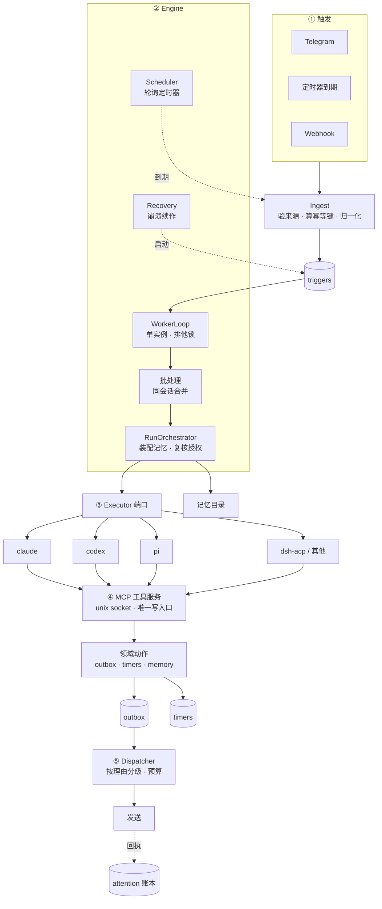
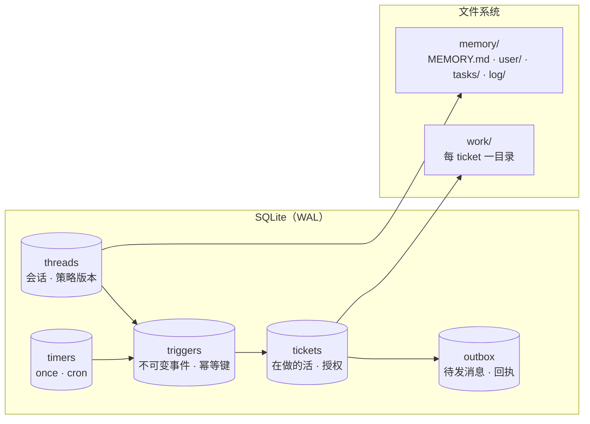

# 001 架构

本文给出分层、持久层和端口。运行语义见 [002 运行与恢复](002-runtime.md)，授权语义见 [003 授权](003-authorization.md)，执行器见 [004 执行器](004-executors.md)。

## 全景



## 六条硬边界

违反其中任何一条，都是设计错了，不是风格问题。

1. **任何代码都不许直接调用 agent。** 唯一入口是 `triggers` 表。这挡住两个失败：两个事件同时到会起两个互相踩的 run；崩了事件就丢了。
2. **agent 不直接发消息，只写 `outbox`。** 于是"发不发、什么时候发、发几条"变成可审计、可拦截、可降频的数据决策，而不是埋在 prompt 里。
3. **worker 只有一个。** 不是约定，是用排他锁（`proper-lockfile`）拿住，第二个进程直接拒绝启动。
4. **只有 Engine 写这五张表。** 其他所有代码都是读或者请求 Engine。这是 dsh-superagent 的 "one writer per state"。
5. **`core` 不做 IO，不 import 任何外部模块。** 它是唯一能用内存实现跑测试的部分，而整套正确性论证都建立在它能被测试之上。
6. **`engine` 不认识任何具体执行器。** 它只认 `Executor` 接口。

## 持久层：五张表 + 一棵目录



| 表 | 回答什么问题 |
| --- | --- |
| `threads` | 这是哪个会话？依据哪版策略？ |
| `triggers` | 发生了什么？处理了没有？为什么忽略？ |
| `tickets` | 在做哪件被允许的事？停在哪一步？凭什么？ |
| `outbox` | 有什么话没说完？说出去没有？ |
| `timers` | 什么时候该自己醒过来？ |

### 关键字段

```sql
threads(id, channel, address, policy_version, created_at)

triggers(id, source, dedupe_key UNIQUE, thread_id, payload,
         received_at, state, lease_until, attempts, ticket_id)
         -- state: pending | claimed | settled | ignored

tickets(id, thread_id, stage, executor_id, mandate, created_at, ended_at)
         -- mandate: { policy_version, strength, basis, scope, rules[] }

outbox(id, ticket_id, ordinal, dedupe_key UNIQUE, body, reason,
       state, sent_at, external_id, replied_at, reply_latency_ms)
         -- state: pending | sending | sent | uncertain | suppressed | failed
         -- reason: needs_decision | task_result | anomaly
         --         | scheduled_report | suggestion | error

timers(id, kind, due_at, cron, thread_id, prompt, enabled, last_fired_at)
         -- kind: once | recurring

sessions(thread_id, executor_id, ref, created_at, last_used_at,
         PRIMARY KEY (thread_id, executor_id))
```

`sessions` 的主键是 `(thread_id, executor_id)` 两列——同一会话可以同时持有多个执行器的会话指针，于是"摘要类任务用便宜的执行器、改代码用强的"不会互相冲掉续作能力。

`outbox.reason` 是 agent 调 `send` 时的**必填枚举**，不是自由文本。这是账本能算的前提：自由文本分类不出来，"该不该降频"就只能凭感觉。

## 记忆是目录，不是表

```
~/.violet/
├── violet.db
├── memory/
│   ├── MEMORY.md        # 索引，每次 run 加载
│   ├── user/*.md        # 关于你的事实，按需读
│   ├── tasks/*.md       # 进度，按需读
│   ├── archive.md       # 过时条目
│   └── log/2026-11-15.md
└── work/<ticket-id>/
```

原则：**只存查不回来的东西。** 已经在别处的东西存指针。

加载策略是两层：索引常驻上下文，正文由 agent 主动 `memory_read` 取。不要一次全塞进去，见 [principle-guard-the-context-window]。

## 端口

`core` 只依赖这些接口，零实现零 IO：

```ts
export interface Repositories { /* 五张表的读写 */ }
export interface Source       { poll(): AsyncIterable<RawEvent> }
export interface Policy       { version: string; gate(t, th, tickets): GateResult }
export interface Assessor     { request(candidate: Candidate): void }
export interface Executor     { start(ticket): void; stop(ticket, reason): void }
export interface Outbox       { send(message): void; status(id): ReplyStatus }
```

`Engine` 是唯一改变域状态的地方。它的接口按调用方切分，每个适配器只能看见它该看见的命令：

```ts
export type EngineForSources  = Pick<Engine, 'receive' | 'bindThread'>
export type EngineForAssessor = Pick<Engine, 'decide'>
export type EngineForExecutor = Pick<Engine, 'started' | 'turnEnded' | 'deliveryFailed'>
export type EngineForPeople   = Pick<Engine, 'stopTicket' | 'retryTicket' | 'answer'>
```

Source 不能调 `decide`；Executor 不能调 `receive`。这是 dsh-superagent 的做法，它的理由写得很清楚：端口要"命名它用到的那些东西"，而不是把整个 Runtime 递出去。

## 目录

```
violet/
├── packages/
│   ├── core/              纯领域：类型、端口、Engine、阶段判断、原因码
│   ├── store/             SQLite 实现：DDL 与查询
│   ├── sources/           telegram · cron · webhook
│   ├── executor/          接口 + claude / codex / pi / acp
│   ├── memory/            文件记忆：索引、按需读、写入脱敏
│   └── delivery/          dispatcher 与渠道发送
├── apps/
│   └── agent/             组装根：配置、装配、启动、优雅关闭
├── docs/
└── tests/
```

### 依赖规则

- `core` 不 import 任何外部模块，不做 IO。除 Node 自带的哈希。
- `sources` 不 import `apps/`。
- `apps/` 是唯一组装根，模块之间通过 `createX(deps)` 拿依赖，模块不 import 组装根。
- 面板（将来）只 import 类型。

`core` 用内存实现跑测试，`store` 用真实 SQLite 跑集成测试。两级都要有。
