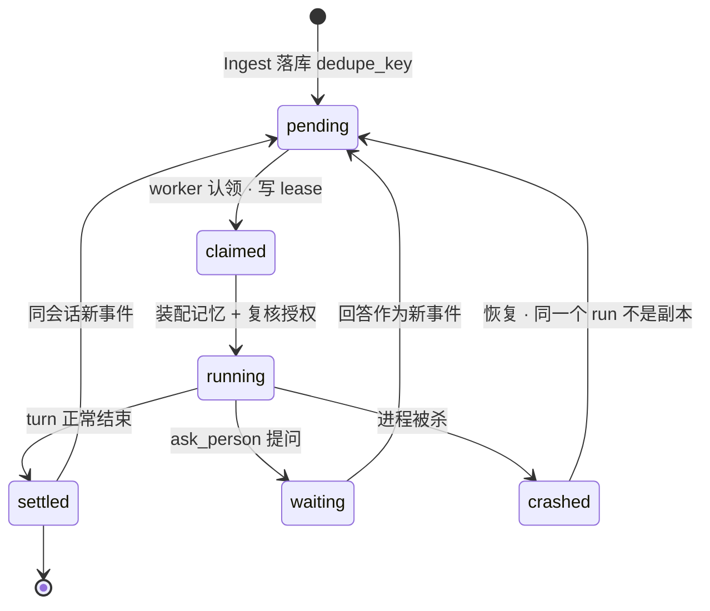

# 002 运行与恢复

这篇是 Violet 唯一真正难的部分。其他都是工程，这里是正确性。

## run 的一生



## 四条幂等契约

### R1 · 事件去重靠幂等键

`dedupe_key = sha(source + external_id)`，插入时 `ON CONFLICT DO NOTHING`。

Telegram 重投、轮询重读、scheduler 二次触发，都只能产生一条事件。

### R2 · 消息先落库，再发送

run 在**一个事务里**把所有出站消息写好再退出。dispatcher 只读表，永远不知道 run 存在过。

崩溃的 run 留下 `pending` 行，下一轮 dispatcher 照发。**run 不会为了重发而重跑。**

### R3 · 承认一个无法消除的窗口

`outbox` 从 `sending` 到 `sent` 之间有几毫秒，渠道 API 和本地写回之间存在窗口，这里没有幂等键可用。

选择是：**接受"可能重复"，绝不接受"可能丢失"。**

所以发送前先写 `state='sending'`，崩溃会留下一条 `uncertain` 的可见记录。你看到一条"可能重复"是难受的，静默丢一条是对的却是不可接受的——后者会让你再也不敢信任它。

同样的诚实出现在 dsh-superagent 的 `steer` 返回值上：`steered` / `refused` / `indeterminate`，注释写明 `indeterminate` 时调用方**绝不能**重新排队，否则会跑两次。

### R4 · 崩溃的 run 不重放，只续作

事件退回 `pending`，会话指针还在，下一轮用同一会话开**新** run，附一句"上次被打断了"。

理由：`git push`、发消息这些副作用不可重放；而会话续作可以。dsh-superagent 的 `003-execution.md` 就是这个做法（interrupted assignment restarts with a recovery note）。

## 认领用 lease，不删行

```
pending → claimed: UPDATE triggers SET state='claimed', lease_until=now+60s
                   WHERE id IN (SELECT ... LIMIT n) AND state='pending'
                   RETURNING *
```

worker 死在半路，lease 过期后事件自动回到可认领状态。不需要"清理僵尸"的独立流程。

心跳续租；超过重试上限（默认 3 次）转 `failed`，并通过 outbox 报一次错，然后不再重试。

## 批量合并

同一会话在一批里有多条 `pending` 事件时，合并成一个 run：

- 如果都是你的消息：按到达顺序拼成一段，只回一次。
- 如果混了定时器和你的消息：以你的消息为主，定时器内容作为背景附上。

不合并的后果是连发三条消息得到三段回复，这比不回复更消耗注意力。

## 定时器与错过的触发

`scheduler` 每隔固定间隔扫 `timers`，到期的转成 trigger 投进 inbox。`once` 标记完成，`recurring` 把 `due_at` 推到下一次。

**进程停机期间错过的触发**，规则是：

| 错过多久 | 处理 |
| --- | --- |
| ≤ 12 小时 | 合并成**一次**补跑 |
| > 12 小时 | 不补跑，只留一条"错过 N 次"的记录 |

这条规则不这么做的话，笔记本合盖一夜、第二天开机会收到七个昨天的日报，一次就把信任烧光。数字来自 OpenMausBot 的 `routine-schedules.md`，它踩过。

## 提问：结束这一轮，不是挂起

`ask_person(question, options[])` 的行为是：

1. 写一条 `ticket.stage = 'person/answer'`
2. 把问题写进 outbox
3. **结束当前 run**
4. 你的回答作为新 trigger 进来，续同一个会话开新 run

它不是"进程挂起等着"，这一条很重要：三家 CLI 对"运行中注入输入"的支持各不相同（claude 的 stream-json input、codex 的实验性 app-server、pi 的 rpc），依赖它就等于绑死在某一家上。

结束这一轮则是最低公共下界——三家都支持"起一个进程，给它一个 prompt，拿回结果"。

## 会话指针

```sql
sessions(thread_id, executor_id, ref, created_at, last_used_at,
         PRIMARY KEY (thread_id, executor_id))
```

会话的**正文**由 CLI 自己存在它的 home 目录，我们只存指针。收益是零维护成本，风险是指针失效（CLI 升级、清缓存、换机器）。

处理方式取决于执行器的 `strictResume` 能力：

| 能力 | 指针失效时 |
| --- | --- |
| `resume: 'strict'` | **报错**，不自动降级。由你决定要不要开新会话 |
| `resume: 'best-effort'` | 开新会话，system prompt 里附进度摘要 |

绝不静默给一个空白会话——那会让你以为它还记着。摘要来自 `memory/tasks/`，不来自 CLI 的旧 transcript。

## 优雅关闭

收到 SIGTERM：

1. 停止认领新事件
2. 给正在跑的 turn 最多 10 秒
3. 超时就杀进程树，对应 trigger 退回 `pending`
4. 已写进 outbox 的消息照常在下次启动时发送

进程重启会结束所有 turn 内的后台工作。这是"一轮一进程"的代价，写在 [006 决策记录](006-decisions.md) 里。
