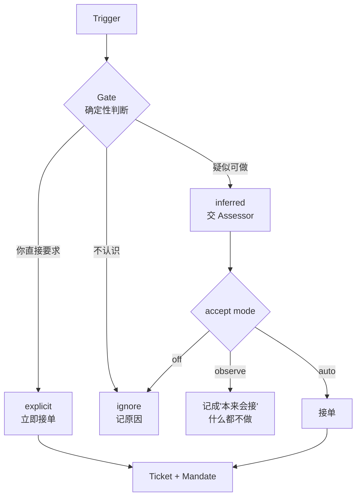

# 003 授权

## 为什么一个人用也需要授权

直觉是"就我一个人用，谁授权的还用记？"——**恰恰是只有一个人用的时候最需要。**

因为你的授权永远是模糊的。"帮我盯着点这东西"，这句话授权它做什么？盯多久？发现了要不要通知？一个月后你只记得说过这么一句，不记得边界。

而它真的会在某个凌晨按自己的理解行动，用的是你的 shell 权限、你的凭据、你的名字。

所以有两件事要分开：

- **Eval** 管"现在要不要动手"——防跑错
- **Mandate** 管"动手了以后能不能说清凭什么"——防没法追责

## 三条路径

每个 Trigger 进来，先过确定性的门，不进这扇门的再说别的：



### Gate：确定性，不过模型

Violet 个人场景只有三条规则：

1. **是你本人，在允许的渠道说的** → `explicit`
2. **定时器到期** → `explicit`（是你自己设的）
3. **其他一切** → `ignore`，记下原因

名单外的人、别的 bot 转发的消息、群里 @ 到的内容，在这里就被挡住，模型不用调。

### Assessor：模型判断

只有 `inferred` 的候选才到这里。输入是事件批次 + 会话快照 + 当前策略，输出四选一：

```
ignore | unavailable | accept | stop
```

它**没有状态、不能执行任何东西、不能改数据库**。只有 Engine 能根据结论建工单。

### accept mode 三档

这一档是整个授权设计里最值得抄的东西：

| 模式 | 行为 |
| --- | --- |
| `off` | 推断出的候选一律不接 |
| `observe`（**默认**） | 会判断，正面判断**只记成"本来会接"**，什么都不做 |
| `auto` | 正面判断就真的接单 |

`observe` 是那个关键。它让你先跑一个月，看它"本来打算做什么"，再决定要不要开 `auto`。

没有这一档，你要么太保守（永远不敢开），要么一开就出事。dsh-superagent 默认就是 `observe`，并写明"先看记录，再决定是否切到 auto"。

## Mandate：一张收据

Eval 说 accept 的那一刻，写下这些东西，写进 `tickets.mandate`：

```ts
{
  policy_version: 'v7',
  strength: 'explicit' | 'inferred',
  basis: 'person' | 'timer' | 'rule:daily-digest',
  scope: '每天早上推送 RSS 更新',
  rules: ['daily-digest']
}
```

### 不可变

只有三种操作能改 Mandate：

1. accept 创建它
2. 人说 stop 撤回它
3. 重新验证失败吊销它

### 策略变了，在跑的活不撤销

策略版本升级时，正在跑的工单不收回来，只给它发一条"规则变了，新内容是……"的通知，让它自己判断要不要停。

理由：取消在跑的工作会留下半成品。这个决定看起来反直觉，但"留一个半成品并要求人收拾"比"让它跑完再说"更消耗注意力。

### 工单结束了还能续

能，但要用**今天的**策略重新验证一遍：

| Mandate 的依据 | 重新验证要求 |
| --- | --- |
| `basis: person` | 那个人还在名单上 |
| `basis: timer` | 定时器还启用 |
| `basis: rule:x` | `auto` 模式 + 规则 x 仍启用 |

验证失败，工单保持结束，那条消息退回 Eval 重新判断。

## 为什么这层能缩

dsh-superagent 用了独立的实体、独立的 session、独立的超时。我们能缩，是因为场景不同：

| | dsh | Violet |
| --- | --- | --- |
| 谁可能发起 | 名单上的人、名单外的群成员、别的 bot、CI | 你，和定时器 |
| Eval | 独立模型调用，逐条规则判断 | M0 是一个函数，M1 才接模型 |
| Mandate | 独立实体表 | `tickets` 上的一个 JSON 字段 |
| 拒绝原因 | 完整的 `Reason` 码表 | 够用就行的几个码 |

**层留着，实现缩小。** `Assessor` 在 M0 是空实现——`gate` 只回答"是不是你、是不是定时器"，都不是就 ignore。等 M0 稳了再填模型判断，接口不用改，因为 `Assessor` 本来就是独立端口。

## 可观测

每个被忽略的 Trigger 都要留一条 `disposition` 记录，带原因码。这是 `observe` 模式能工作的基础，也是出问题时唯一能查的东西。

原因码不要自由文本。自由文本在三个月后没人能聚合。
